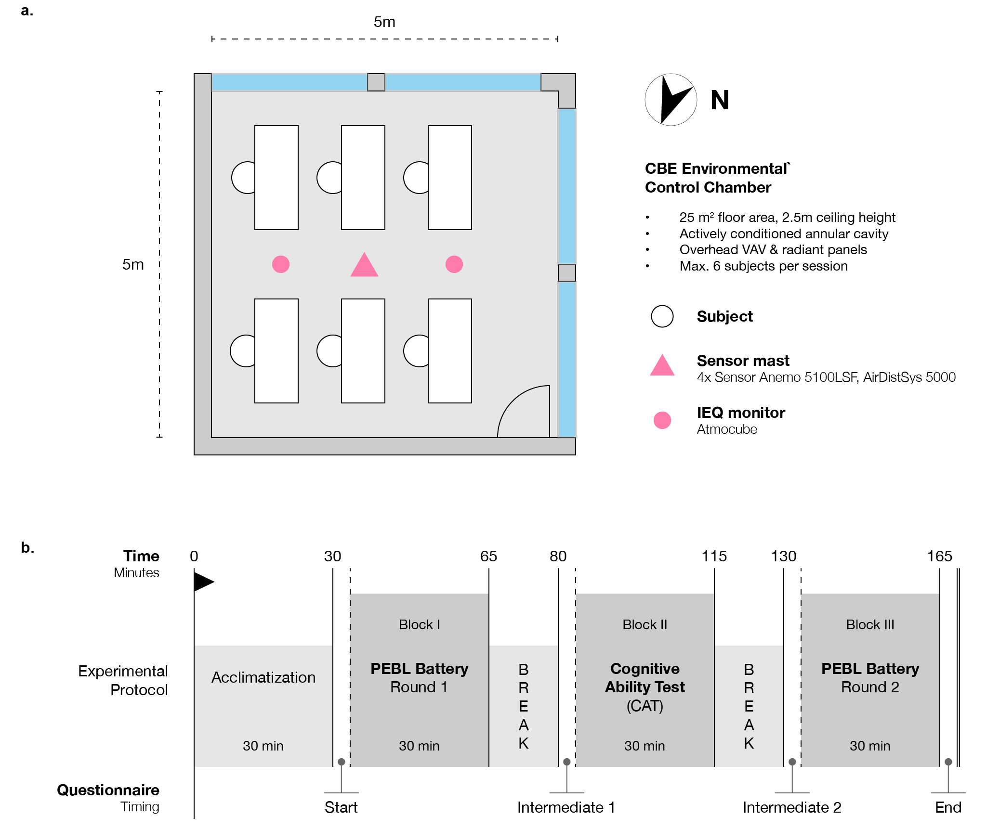
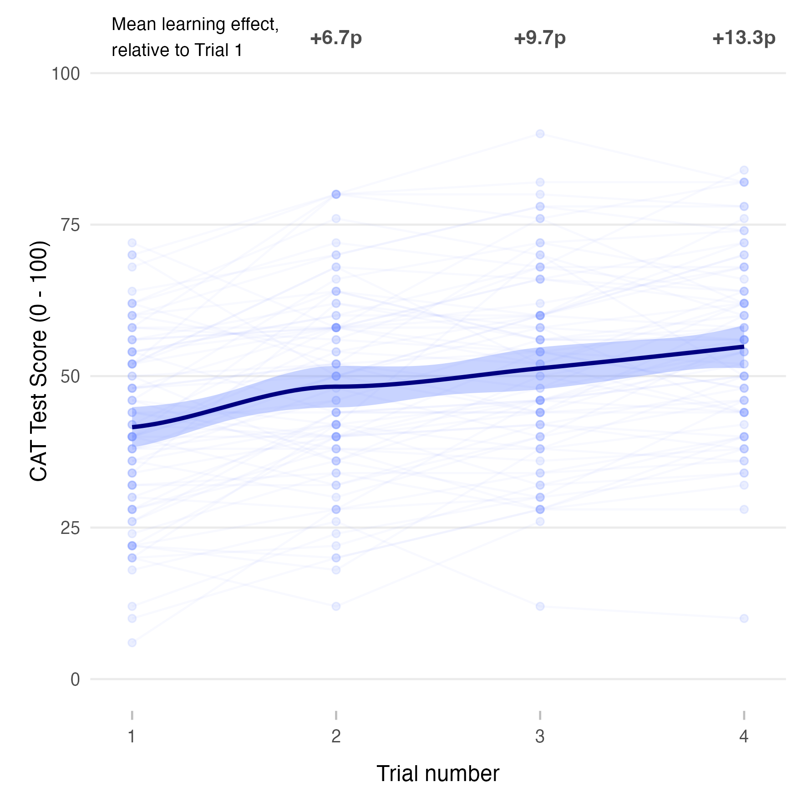

```{r load-main-analysis}
source(here::here("code", "analysis.R"))
```

# Abstract {.unnumbered}

The relationship between indoor temperature and office work performance (OWP) remains contested despite decades of research. Recent laboratory studies, including a controlled experiment in Singapore, report limited or no effects within typical office ranges, but replication across climatic contexts is needed to assess generalizability. A within-subject study was conducted in the temperate climate of the San Francisco Bay Area, closely replicating the Singapore protocol with a 30% larger sample: seventy-five participants completed four 165-min sessions at 21°C, 23°C, 25°C, and 27°C in a controlled environmental chamber. Office work performance was assessed using a Cognitive Ability Test (CAT) and a battery of eight neuropsychological tests targeting five cognitive domains, alongside continuous physiological monitoring. Although participants preferred temperatures between 23–25°C, no statistically significant effect of temperature on cognitive ability or neuropsychological performance was found across the full sample; physiological measures and thermal perception varied with temperature as expected, but without accompanying changes in office work performance. Among the highest-performing quartile of CAT participants, a statistically significant, large-magnitude temperature-related effect was observed, though this pattern was not replicated in the neuropsychological battery. The findings closely align with the Singapore study and are consistent with the Maximal Adaptability Model, adding to the growing body of evidence supporting wider HVAC setpoint ranges. Findings should be interpreted in light of the short-term controlled exposure, the predominantly young and healthy sample, and the temperate-climate setting; longer-duration and more diverse study designs are needed.

# Practice relevance {.unnumbered}

Building managers, HVAC engineers, and sustainability practitioners face increasing pressure to reduce energy consumption from heating and cooling while maintaining occupant work performance; this study provides experimental evidence, replicating a prior controlled study in Singapore, that office work performance was not significantly impaired across a 21–27°C range in a temperate climate (San Francisco Bay Area). These findings suggest that modest upward adjustments to HVAC cooling setpoints within this range are unlikely to reduce cognitive output in typical office populations, supporting strategies that expand acceptable indoor temperature bands as a means of reducing energy usage. Decision-makers should note, however, that thermal comfort and satisfaction remain important even when performance is stable, and that these results are most applicable to temperate-climate offices with predominantly young, healthy workers performing structured task work; longer-duration exposure and more diverse occupant profiles warrant further investigation.

# Keywords {.unnumbered}

Cognitive performance; Thermal comfort; Human subject experiment; Physiological measurements; HVAC design

# Introduction

Numerous studies have examined the influence of the thermal environment on cognitive functioning and office work performance (OWP), yet findings remain inconsistent. At temperatures well outside typical indoor ranges, performance impairment is widely documented [@zhangEffectsModerateThermal2019]. Within the range typically found in mechanically conditioned offices, however, the evidence is mixed. Several laboratory and field studies have reported measurable effects: @tanabeIndoorTemperatureProductivity2007 found inconsistent effects of moderately elevated temperature (up to 33°C) across task types; @maulaEffectSlightlyWarm2016 observed a significant decrement on a working-memory task at 29°C compared with 23°C, while other administered tasks were unaffected; and @lanCognitivePerformanceWas2022 reported reduced cognitive performance across a 24–28°C range even with thermal comfort actively held constant. @gengImpactThermalEnvironment2017 similarly tested a wider 16–28°C range and found performance highest under neutral-to-slightly-cool conditions, declining toward both extremes.

In contrast, other studies have found little or no effect within typical indoor ranges. A meta-analysis of 35 studies by @porras-salazarMetaanalysis35Studies2021 concluded that there is no reliable temperature–performance relationship in the 20–30°C range, and that existing empirical models have low predictive accuracy and are based on limited participant samples. @linEffectsTemperatureWork2025 found in a recent review that effects may be more pronounced for tasks with higher cognitive demand, but that the overall evidence base remains heterogeneous.

Together, these inconsistencies suggest that the relationship between indoor temperature and OWP is task-, context-, and population-dependent, and that methodological heterogeneity, such as sample characteristics, task types, exposure duration, and the degree of environmental control, likely contributes to the variability across studies [@zhangEffectsModerateThermal2019].

A recent study conducted by @porras-salazarEffectIndoorTemperature2024 in Singapore sought to address several of these limitations by evaluating temperature effects on OWP within a controlled experimental setting and by employing a structured set of cognitive performance assessments. Contrary to other work suggesting measurable decrements in performance with increasing deviation from thermally comfortable conditions [@lanCognitivePerformanceWas2022; @linEffectsTemperatureWork2025], the Singapore study did not find conclusive evidence that OWP was affected by temperature within the typical ranges in office buildings.

Two constraints of the Singapore study limit the broader generalization of its results: the sample size (n = 58, large compared to typical studies, but still small to be generalizable) and the specificity of the climatic and cultural context in which it was conducted. Thermal expectations, acclimatization patterns, and building operation practices differ substantially between tropical and temperate regions, and these factors may influence both thermal experience and performance outcomes [@humphreysOutdoorTemperaturesComfort1978; @xiongMeasuringWhatMatters2026]. Additional evidence from temperate office environments is therefore needed to evaluate whether the absence of strong temperature effects reflects a broader pattern or is specific to the conditions and the original participant sample. Independent replication is valuable in its own right and strengthens confidence in single-study findings [@schmidtShallWeReally2009, @popperLogicScientificDiscovery2002], particularly given the policy relevance of temperature–performance research for HVAC design and energy management [@porras-salazarMetaanalysis35Studies2021].

The present study replicates the Singapore experiment in the temperate climate of the San Francisco Bay Area with a substantially larger sample and a practically identical protocol, enabling direct comparison across climatic, building, and cultural contexts. Grounded in the Maximal Adaptability Model [@hancockDynamicModelStress1989], which suggests that individuals can maintain cognitive performance within an adaptive zone despite physiological thermal stress, this study evaluates whether the tested 21–27°C range falls within that zone, whether indoor temperature within it affects short-term cognitive performance, and whether physiological responses and thermal comfort shift with temperature even when cognition does not. It also asks whether the null performance effects reported by @porras-salazarEffectIndoorTemperature2024 replicate in a different climatic and cultural context with a larger sample.

# Methods {#sec-methods}

## Study Design and Setting

The experiment was carried out at the Center for the Built Environment at the University of California, Berkeley, between March and July 2025. During this period, typical daytime maximum outdoor temperatures ranged from 16 to 22°C (10^th^ to 90^th^ percentile) [@NOAA_NWS_SF_Climate_2025].

```{r temp-percentiles, echo=FALSE}

source(here::here("code", "src", "get_temp_percentiles.R"))

```

A total of 84 participants were recruited to attend four sessions and complete two types of cognitive performance assessments under air temperatures of 21°C, 23°C, 25°C, and 27°C. These temperatures were selected to represent typical indoor conditions in the United States. Following the approach used in the original study [@porras-salazarEffectIndoorTemperature2024], indoor temperature data for U.S. office buildings were extracted from the ASHRAE Global Thermal Comfort Database II [@foldvarylicinaDevelopmentASHRAEGlobal2018]. Observations with thermal sensation votes between –1.5 and 1.5 were retained, and the 10^th^, 25^th^, 50^th^, 75^th^, and 90^th^ percentiles were calculated. The resulting values (`r round(quantiles$Q10, 1)`°C, `r round(quantiles$Q25, 1)`°C, `r round(quantiles$Q50, 1)`°C, `r round(quantiles$Q75, 1)`°C, `r round(quantiles$Q90, 1)`°C) led to the selection of the four given temperature set points for the experimental conditions. For the remainder of this paper, these conditions are referred to as "session types" with the following labels: *21C*, *23C*, *25C* and *27C*.

To reduce learning effects associated with the work-performance tests, each participant was randomly assigned a unique session order. The distribution of orders (maximum of 24 different combinations) was balanced across all participants (see @tbl-order-combined in the Appendix), who were then asked to schedule their sessions in the required sequence.

## Environmental Chamber {#sec-chamber}

All sessions were conducted in an environmental control chamber at the Center for the Built Environment, UC Berkeley. The chamber measures 5 × 5 × 2.5 m and replicates a small office environment [@baumanDevelopmentControlledEnvironment1988]. The chamber incorporates an actively conditioned annular cavity surrounding the test space, enabling independent regulation of window surface temperatures and spatial radiant conditions. For this experiment, it could host up to six participants at the same time, each seated at a workstation equipped with a desk, office chair, laptop, and a mouse. @fig-layout-protocol in @sec-protocol shows the room layout in more detail.

A dedicated air-handling unit supplied conditioned air through a variable-air-volume system with fixed ceiling-diffuser terminal positions, keeping ventilation rates constant while supply air temperature was adjusted to maintain the indoor set points. To avoid radiant asymmetry and provide a homogeneous thermal environment, radiant ceiling panels were operated at the same set point temperatures as the VAV system. Other environmental parameters were kept as constant as possible across conditions: relative humidity was maintained at 50–55%, air speeds were kept below 0.1 m/s, and artificial lighting was used only when daylight levels were insufficient to maintain 500 lux. CO~2~ concentration was monitored continuously, including during and after participant breaks, and kept at near-ambient levels through constant supply of fresh air via mechanical ventilation (see @tbl-env).

## Participants

In total, 84 healthy adults who attended at least one experimental session were recruited through flyers, emails, and a campus-wide online recruitment system. Seventy-five participants attended all four sessions and self-reported their sex prior to the study. Demographic characteristics are summarized in @tbl-demographics. For the statistical analysis (@sec-methods-analysis), only data from this subset of participants were used.

```{r demographics, echo=FALSE}
#| label: tbl-demographics
#| tbl-cap: "Summary of demographic information (mean ± SD) on 75 study participants who attended all four conditions."

knitr::kable(demographic_d,
             col.names = c('Sex', 'No. Participants', 'Age [a]', 'Height [m]', 'Weight [kg]', 'Body Mass Index (BMI)')
)
```

### Sample Size and Statistical Power

The target sample size was set at approximately 30% larger than the Singapore experiment (n = 58) to improve statistical power and the precision of effect size estimates. An a priori power analysis confirmed adequate statistical sensitivity for the within-subjects design. A intraclass correlation coefficient (ICC = `r round(icc_cat, 2)`) estimated from the linear mixed-effects model reflects the high between-participant consistency in CAT scores. Applying the corresponding within-subjects non-centrality parameter (see @eq-lambda), the design provided `r round(power_rm * 100, 1)`% power at α = 0.05 to detect an effect as small as ηp² = 0.01 (Cohen's f = `r round(porras_f, 3)`). This exceeds the conventional 80% criterion.

$$
\lambda = \frac{n \cdot k \cdot f^2}{1 - ICC}
$$ {#eq-lambda}

### Eligibility and Session Requirements

All materials and tests were in English, so sufficient English proficiency was a strict requirement. All participants provided written informed consent prior to enrolment. Before the experimental sessions, participants attended an onboarding meeting where they were able to practice the cognitive tests and learned how the physiological equipment would be attached and used.

Participants self-reported the absence of chronic cardiovascular or respiratory conditions, major surgeries within the past year, and sleep disorders. They had all lived in the San Francisco Bay Area for at least six months. No medical examinations were conducted. Participants were instructed to avoid alcohol or drug use for 24 hours before each session, sleep adequately, and refrain from vigorous exercise or smoking for at least one hour before arrival. Participants were also asked to wear the same type of clothing at every session: a short-sleeved shirt or blouse, lightweight long trousers, socks, and closed shoes. This corresponds to an estimated clothing insulation level of 0.6 clo (including the chair) and typical office attire in the region. Compliance with these requirements was self-reported at arrival. Participants who did not meet the protocol conditions (for example, incorrect clothing) were asked to return on a later date.

### Compensation

Participants were compensated with hourly gift vouchers and received performance and completion bonuses to encourage consistent attendance and effort, with participants scoring in the top 20% across all cognitive performance tests receiving additional bonus prize payments ranging from US\$150 to US\$30 depending on their results. Performance-based incentives were used intentionally as an analogue for the motivational factors (intrinsic interest, professional expectations, career consequences) that shape effort in real office settings, consistent with established practice in experimental psychology research on motivated performance [@bonnerEffectsMonetaryIncentives2002].

## Measurements

### Environmental Conditions

The physical environment was monitored continuously at 1-minute intervals using a sensor mast located at the room center (air temperature and air speed at four heights: 0.1 m, 0.6 m, 1.1 m, and 1.7 m) and two Atmocube IEQ monitoring units placed at representative desk locations (air temperature, relative humidity, CO~2~, particulate matter, light intensity, and background noise). Records of the chamber's temperature thermostat were also exported. Full instrument models and accuracy specifications are provided in the Appendix ("Instrumentation").

Air temperature was controlled to remain within ±0.5°C of the set point in all conditions while maintaining the other parameters within narrow ranges. The mean CO~2~ stayed below 580 ppm, indicating that the room was abundantly ventilated.

```{r env, echo=FALSE}
#| label: tbl-env
#| tbl-cap: "Mean values for key environmental parameters measured during sessions measured at 1.1m height; temperature measurements are averages from the central-mast sensor and the two Atmocube units (standard deviation in brackets)."

knitr::kable(env_summary,
             col.names = c('Session', 'T~air~ [°C]', 'RH [%]', 'CO~2~ [ppm]')
             )

```

### Subjective Assessments

At their first visit, participants completed an onboarding questionnaire that included demographics, self-reported health patterns, the Highly Sensitive Person scale [@aronSensoryProcessingSensitivityIts1997], the Satisfaction with Life Scale [@dienerSatisfactionLifeScale1985], and the Ten-Item Personality Inventory [@goslingVeryBriefMeasure2003].

During each experimental session, participants completed short questionnaires at four time points spaced across the protocol (see Experimental Procedure). The questionnaire content followed the same structure described by @porras-salazarEffectIndoorTemperature2024 and is available in the public repository associated with that publication. All questionnaires were administered online via Qualtrics.

### Physiological Measurements

Dorsal skin temperature and heart activity were monitored continuously. For skin temperature, iButton sensors (DS1923, USA, 20°C to 85°C, accuracy: ±0.1°C, resolution: 0.0625°C) were attached to the back of the non-dominant hand using medical tape and data were logged at 1-minute intervals. In addition, heart rate and heart rate variability were measured using the Polar H10 (Polar Electro Oy, Finland) chest strap paired with the Elite HRV app. Participants wore the strap in direct contact with the skin. Raw RR interval data were extracted and used to calculate heart rate (HR), heart rate variability (HRV) and Root Mean Square of Successive Differences (RMSSD). HR and RMSSD served as indices of autonomic and parasympathetic activity, respectively [@shafferOverviewHeartRate2017].

### Work-Performance Assessments {#sec-assessments}

Cognitive performance was assessed using two types of tests. The first was a neuropsychological assessment using eight tests from the PEBL Psychological Test Battery, a validated open-source platform with established psychometric properties [@muellerPsychologyExperimentBuilding2014], measuring performance across five cognitive domains: Working Memory, Executive Function, Attention, Processing Speed, and Decision Making. Participants completed this test battery twice during each session (see Experimental Procedure for timing). @tbl-cognitive-domains provides an overview of the cognitive domains, applied tests from the PEBL battery, and primary outcome metrics used in this study. Each individual paradigm employed is independently validated across neuropsychological literature [@shermanCompendiumNeuropsychologicalTests2022; @LezakMurielDeutsch2012Na; @diamond2013].

```{r}
#| label: tbl-cognitive-domains
#| tbl-cap: "Cognitive domains assessed with PEBL test battery and sorted in the order in which they were completed."
#| echo: false

domain_summary_table <- tibble::tribble(
  # ~Test, ~`Cognitive Domain`, ~`Cognitive Process`, ~`Test Metrics`,
  ~Test, ~`Cognitive Domain`, ~`Test Metrics`,

  "Berg Card Sorting Test (BCST)",
  "Executive Function",
  # "Cognitive flexibility and set-shifting",
  "Perseverative errors, Trials",

  "Corsi Blocks",
  "Working Memory",
  # "Visuospatial working memory capacity",
  "Span, Correct trials",

  "Flanker Task",
  "Attention",
  # "Selective attention and inhibitory control",
  "Response time, Accuracy",

  "Match-to-Sample",
  "Attention",
  # "Visual recognition and sustained attention",
  "Response time, Accuracy, Errors",

  "Paired Associates",
  "Working Memory",
  # "Associative learning and memory",
  "Correct responses, Errors",

  "Tower of London (ToL)",
  "Executive Function",
  # "Planning and problem-solving",
  "Moves, Time",

  "Trail Making (Simple + Mixed)",
  "Processing Speed / Executive Function",
  # "Set-shifting and cognitive flexibility",
  "Time, Clicks",

  "Balloon Analog Risk Task (BART)",
  "Decision Making",
  # "Risk-taking behavior and reward processing",
  "Mean/Total pumps"
)

knitr::kable(domain_summary_table, align = "llll")
```

Descriptions of each PEBL subtest are provided in the Appendix ("PEBL Test Descriptions"), with full methodological descriptions also available in @porras-salazarEffectIndoorTemperature2024. Participants could exit individual tests before completion. Any run with fewer than 80% of expected responses was excluded from analysis, as described in @sec-methods-analysis.

For the second type of assessment, participants completed a Cognitive Ability Test (CAT) similar to the Wonderlic assessment [@hunterWonderlicScholasticLevel1989], which included 50 multiple-choice questions to be answered within 12 minutes. The questions covered numerical reasoning (\~40%), logic and deductive reasoning (\~20%), verbal reasoning (\~26%), and general knowledge (\~14%). Participants could use pen and paper but not calculators and could work on the question without following a specific order. Participants completed the CAT once per session.

## Experimental Procedure {#sec-protocol}

A repeated-measures design was used. Each participant was exposed to all four temperature conditions and served as their own control. Two sessions per day were conducted, starting at either 9:00 AM or 2:00 PM, from Monday through Friday. Participants could attend sessions at different times of day, the time of day was therefore a potential source of within-person variability. However, because the session order, and with it the association between any given temperature condition and time of day, was fully counterbalanced across participants, no temperature condition was systematically over-represented in morning or afternoon slots at the group level, making systematic confounding by time of day unlikely. An overview of the session order distribution is provided in @tbl-order-combined in the Appendix.

Participants were asked to schedule sessions according to their assigned exposure order, but were otherwise given flexibility to attend sessions whenever their schedule allowed. The only firm constraint was that no two sessions could be completed on the same calendar day. Most participants completed all four sessions within a time frame of two weeks, although some needed slightly longer because of short study breaks due to holidays and exam periods. Each session lasted 165 minutes. Participants arrived 15 minutes early to attach the heart-rate strap and skin temperature sensors.

Each participant followed their own schedule and began a 30-minute acclimatization period once seated in the chamber. During this time, participants sat quietly at their workstations and no structured tasks were assigned; they were free to read or use their phone, but no work or cognitive tasks were given. Since @porras-salazarEffectIndoorTemperature2024 observed a lack of acclimatization, for this study, the acclimatization period was extended by 15 minutes relative to the original protocol. After the acclimatization period, participants completed three testing blocks separated by 15-minute breaks. Participants could drink water or leave the room for up to five minutes during breaks; those who exited were required to wait 15 minutes before starting the next block.

{#fig-layout-protocol}

Participants completed questionnaires at four points across the protocol: at arrival ("Start"), after the first test block ("Intermediate 1"), after the second test block ("Intermediate 2"), and at the end of the session ("End"). They completed the PEBL Test Battery twice, at the beginning and end of the session (Block I and III), and the CAT once, during the middle block (Block II). The test order remained the same for all participants across all sessions. The experimental protocol was approved by the Committee for the Protection of Human Subjects of the University of California, Berkeley (CPHS 2024-11-18013).

## Data Processing and Analysis {#sec-methods-analysis}

All raw environmental, physiological, and cognitive performance data were imported and organized using *Python* and the *pandas* [@mckinneyPython2018] library. Separate data streams were merged using the session ID, participant ID, and datetime information.

For statistical analysis, only participants who completed all four sessions were included (n = `r demographic_d$n[demographic_d$sex == "all"]`), since the repeated-measures ANOVA requires a fully balanced design. The statistical analysis was performed in *R* using the *tidyverse* [@Wickham2019-tidyverse] and *rstatix* [@kassambaraRstatix2023] packages. All visualizations were generated using *ggplot2* [@wickhamGgplot2ElegantGraphics2016]. For all repeated-measures ANOVAs, sphericity was assessed using Mauchly's test and Greenhouse-Geisser corrections were applied when sphericity was violated (p \< 0.05). Partial eta-squared (ηp²) is reported as the measure of effect size, using the thresholds originally proposed by @cohenStatisticalPowerAnalysis1988: ηp² \< 0.01 as negligible, 0.01–0.06 as small, 0.06–0.14 as medium, and \> 0.14 as large.

To complement null hypothesis significance testing and properly characterise null results, equivalence tests were conducted for primary cognitive outcomes using the omnibus F-test approach, an ANOVA-based generalisation of the two one-sided tests (TOST) procedure [@campbellCanWeDisregard2021]. The equivalence bound was set at ηp² = 0.01, consistent with the @cohenStatisticalPowerAnalysis1988 negligible-effect threshold and the smallest effect size that the Singapore study was designed to detect [@porras-salazarEffectIndoorTemperature2024]. Thermal perception responses (sensation, preference, and acceptability) are ordinal and were therefore analysed using Friedman tests with Bonferroni-corrected post-hoc pairwise comparisons. As a sensitivity check, the primary CAT analysis was also repeated using a linear mixed-effects model with a random intercept per participant (*lmerTest* package [@kuznetsovaLmerTestPackageTests2017]; Satterthwaite degrees of freedom).

To account for missing or incomplete data arising from technical issues or participants inadvertently exiting tests early, the following inclusion criteria were applied: For the CAT test, only fully completed samples were included. For the PEBL battery, which required participants to complete two rounds (Block I and Block III) with multiple runs per test, data from a session were included if at least one complete round was finished. A test was considered complete if the participant finished at least 50% of the standard number of runs (e.g., a minimum of 2 out of 3 required runs), and a run was counted as complete if it contained at least 80% of the expected responses. Overall, missing and incomplete data were minimal, with only 0.3 % of runs affected. On three occasions, participants were mistakenly administered the CAT form from an earlier session rather than the form intended for that session, meaning they had already seen the questions; these sessions' CAT scores were therefore excluded from analysis.

# Results

## Environmental Conditions

@tbl-env summarizes the environmental conditions for each session type; values represent session means at 1.1 m height, the standard reference height for the occupied zone, averaged from the central-mast sensor and the two Atmocube units. Air temperature was maintained within ±0.5°C of each target set point throughout the study. Because the chamber's actively conditioned annular cavity and ceiling-mounted radiant panels operated at the same set point as the air, window and surface temperatures closely tracked air temperature, allowing air temperature, mean radiant temperature, and operative temperature to be used interchangeably for interpretation [@daweComparisonMeanRadiant2020]. Relative humidity, CO~2~, and other monitored variables also remained within their prescribed ranges across all four session types.

## Thermal perception

Each of the four questionnaires outlined in the protocol graphic (@fig-layout-protocol) contained a set of questions targeting thermal perception. These included questions on (a) thermal sensation, (b) thermal preference, and (c) thermal acceptability, and used the ordinal scales recommended in ASHRAE 55 [@ashraeANSIASHRAEStandard2023]. This generated up to 300 responses per question and condition (75 participants × 4 questionnaire time-points per session).

Thermal responses across the four temperature conditions showed a consistent progression in sensation, preference, and acceptability (@fig-thermal-perception). At 21°C, participants predominantly reported *slightly cool* and *cool* sensations, with a clear preference for *warmer* conditions (`r thermal_preference_d %>% filter(session_type == "21C", thermal_preference == "warmer") %>% pull(pct_label)`), though acceptability remained largely positive. At 23°C, sensations shifted toward *neutral* and most participants preferred *no change* (`r thermal_preference_d %>% filter(session_type == "23C", thermal_preference == "no change") %>% pull(pct_label)`), indicating that this condition was close to thermal neutrality, with acceptability reaching its highest levels (*very acceptable*: `r thermal_acceptability_d %>% filter(session_type == "23C", acceptability_thermal == "very acceptable") %>% pull(pct_label)`). At 25°C, sensations spread across *neutral*, *slightly warm*, and *slightly cool*, with preference still dominated by *no change* but an emerging tendency toward *cooler*; acceptability remained high. By 27°C, sensations shifted clearly toward the warm side, most participants preferred the environment *cooler* (`r thermal_preference_d %>% filter(session_type == "27C", thermal_preference == "cooler") %>% pull(pct_label)`), and acceptability decreased, with notable increases in unacceptable ratings. Overall, the three constructs followed a coherent pattern: participants felt predominantly too cool at 21°C, near neutral around 23–25°C, and mostly too warm at 27°C, with preference and acceptability shifting accordingly. This convergence across sensation, preference, and acceptability indicates a consistent range of thermal comfort centered between approximately 23°C and 25°C.

Friedman tests confirmed statistically significant effects of temperature on all three perception measures. Thermal sensation showed the strongest concordance (χ²(`r friedman_sensation$df`) = `r friedman_sensation$statistic`, p \< 0.001, Kendall's W = `r friedman_sensation$kendalls_w`), with all six pairwise comparisons between conditions differing significantly after Bonferroni correction (all p~adj~ \< 0.001). Thermal preference showed similarly strong agreement (χ²(`r friedman_preference$df`) = `r friedman_preference$statistic`, p \< 0.001, W = `r friedman_preference$kendalls_w`), again with all pairs distinguishable. Thermal acceptability also differed significantly across conditions (χ²(`r friedman_acceptability$df`) = `r friedman_acceptability$statistic`, p \< 0.001, W = `r friedman_acceptability$kendalls_w`), though with weaker overall concordance. Post-hoc comparisons indicated that 27°C was rated significantly less acceptable than 23°C and 25°C, and 23°C was rated more acceptable than 21°C, while differences between 21°C and 25°C and between 23°C and 25°C were not significant, meaning they offered roughly equivalent, high levels of acceptability.

{#fig-thermal-perception}

## Office work performance

### Cognitive Ability Test (CAT)

Overall cognitive performance was assessed using the Cognitive Ability Test (CAT). As shown in Figure @fig-cat (a), average CAT scores for the full sample were broadly similar across the four temperature conditions, ranging from `r min(cat_all_d$mean_score)` to `r max(cat_all_d$mean_score)` points. Participants performed best, on average, in the `r cat_all_d$session_type[which.max(cat_all_d$mean_score)]` condition (mean = `r cat_all_d$mean_score[which.max(cat_all_d$mean_score)]`, SD = `r cat_all_d$sd_score[which.max(cat_all_d$mean_score)]`) and lowest in `r cat_all_d$session_type[which.min(cat_all_d$mean_score)]` (mean = `r cat_all_d$mean_score[which.min(cat_all_d$mean_score)]`, SD = `r cat_all_d$sd_score[which.min(cat_all_d$mean_score)]`). The remaining conditions fell between these values, with no clear monotonic trend. A repeated-measures ANOVA supported this visual impression, indicating no statistically significant effect of temperature on CAT performance within the examined temperature range (F(`r anova_stats_all$DFn`, `r anova_stats_all$DFd`) = `r anova_stats_all$F`, p = `r anova_stats_all$p`, ηp² = `r anova_stats_all$pes`). Because a non-significant result alone cannot establish the absence of an effect, an equivalence test was also conducted. It indicated that the observed effect could not be characterised as practically negligible at the previously specified bound (ηp² = `r tost_cat_all$pes_bound`; p~equiv~ = `r tost_cat_all$p_value`), suggesting that a small true effect of temperature on work performance cannot be entirely ruled out.

{#fig-cat}

CAT scores rose consistently across the four repeated administrations, independent of session temperature (see Appendix, "CAT Learning Effect"), motivating the use of a linear mixed-effects model with trial number as a covariate, rather than a simple mean correction, in the performer-subgroup analysis below.

#### High and low performing participants {#sec-high-low}

To explore whether higher and lower performing individuals responded differently to temperature, the analysis was repeated separately for the top and bottom 25% of participants by average CAT score (see @fig-cat). Because subgroup membership was not known before the experiment, session order was less balanced within these groups than in the full cohort (see @tbl-order-combined). A linear mixed-effects model was fitted for each subgroup with session type and trial number (1–4) as fixed effects and a random intercept per participant, estimating the temperature effect after accounting for individual-level learning. Scores displayed in @fig-cat (b) retain the mean-corrected adjustment described in the Appendix ("Learning Effect") for visual interpretability; all reported statistics derive from the LMM.

Low performers (@fig-cat (b), left) exhibited a narrow range of mean scores, from `r min(cat_low_performer_d$mean_score)` to `r max(cat_low_performer_d$mean_score)` points. The LMM for this subgroup revealed no statistically significant effect of temperature on CAT scores after controlling for trial number (F(`r anova_stats_low_performer$DFn`, `r anova_stats_low_performer$DFd`) = `r anova_stats_low_performer$F`, p = `r anova_stats_low_performer$p`, ηp² = `r anova_stats_low_performer$pes`). Equivalence testing likewise did not confirm a negligible effect at the pre-specified bound (p~equiv~ = `r tost_cat_low_performer$p_value`).

High performers (@fig-cat (b), right) showed a wider spread in mean scores, from `r min(cat_high_performer_d$mean_score)` to `r max(cat_high_performer_d$mean_score)` points. In contrast to the full sample, the LMM identified a statistically significant effect of temperature on CAT scores in this subgroup after controlling for trial number (F(`r anova_stats_high_performer$DFn`, `r anova_stats_high_performer$DFd`) = `r anova_stats_high_performer$F`, p = `r anova_stats_high_performer$p`, ηp² = `r anova_stats_high_performer$pes`), representing a large effect by @cohenStatisticalPowerAnalysis1988 criteria (ηp² \> 0.14). Equivalence testing confirmed that the observed effect substantially exceeded the pre-specified negligible bound (p~equiv~ = `r tost_cat_high_performer$p_value`). Exploratory post-hoc pairwise comparisons on mean-corrected scores (Bonferroni correction) indicated that the largest difference was between the `r posthoc_high_performer$group1[which.min(posthoc_high_performer$p.adj)]` and `r posthoc_high_performer$group2[which.min(posthoc_high_performer$p.adj)]` conditions (p~adj~ = `r min(posthoc_high_performer$p.adj)`). This finding suggests that higher-performing individuals may be more sensitive to temperature variations, even though the broader sample showed no statistically significant performance changes.

As a sensitivity check, a linear mixed-effects model with a random intercept per participant applied to the full sample yielded consistent results (F(`r cat_lmm$DFn`, `r round(cat_lmm$DFd, 0)`) = `r cat_lmm$F`, p = `r cat_lmm$p`), confirming robustness to the analytical approach.

### PEBL Test Battery

PEBL Test Battery performance across the five cognitive domains (@tbl-cognitive-domains) is summarized in @fig-pebl, which visualizes changes by temperature condition relative to the 21°C baseline. Overall, cognitive performance remained stable across temperature conditions, with mean changes ranging from a minimum of `r min(pebl_domain_d$mean_change[pebl_domain_d$domain == "Overall"])`% at 23°C to a maximum of `r max(pebl_domain_d$mean_change[pebl_domain_d$domain == "Overall"])`% at 25°C, both relative to baseline. These small fluctuations were inconsistent across domains and showed no systematic temperature-related pattern.

Attention showed the largest variability across conditions, with changes reaching `r pebl_domain_d$mean_change[pebl_domain_d$domain == "Attention" & pebl_domain_d$session_type == "25C"]`% at 25°C alongside substantial inter-individual variability, followed by Decision Making (up to `r pebl_domain_d$mean_change[pebl_domain_d$domain == "Decision Making" & pebl_domain_d$session_type == "27C"]`% at 27°C). Working Memory and Executive Function changes were comparably modest, and Processing Speed was the most consistent domain.

Detailed test-by-test results and statistical analyses are provided in @tbl-pebl-detailed in the Appendix. After excluding parameters that showed ceiling effects or negligible variation across conditions (changes \< 1%), none of the retained PEBL metrics showed a statistically significant effect of session temperature (all p \> `r min(pebl_tbl_wide$p_value)`), with percent changes relative to the 21°C condition generally small (±1–5%).

To provide a more interpretable summary across the large number of individual metrics, domain-level composite scores were computed by z-scoring each metric across all participants and sessions, reversing the sign for lower-is-better measures (response times, variability, and move-count metrics), and averaging within domain (Decision Making excluded, as BART measures risk-taking tendency rather than performance accuracy). Domain-level repeated-measures ANOVAs confirmed no statistically significant temperature effect for any of the four retained domains (n = `r pebl_domain_tost$working_memory$n`; Greenhouse-Geisser corrected where sphericity was violated — Executive Function, Attention, and Processing Speed; see @tbl-pebl-domain). Equivalence testing confirmed a negligible temperature effect only for Working Memory (p~equiv~ = `r pebl_domain_tost$working_memory$p_equiv`); for the remaining three domains, equivalence at the ηp² = 0.01 threshold could not be confirmed, so small effects of temperature on work performance in these domains cannot be fully ruled out.

```{r}
#| label: tbl-pebl-domain
#| tbl-cap: "Domain-level PEBL composite results. Z-score composites were computed by averaging direction-corrected metrics within each cognitive domain. Greenhouse-Geisser corrections applied where sphericity was violated (df₁ < 3). Decision Making excluded (BART measures behavioural tendency, not performance accuracy). p~equiv~ from equivalence F-test with bound η~p~² = 0.01."

knitr::kable(
  pebl_domain_tost_tbl,
  col.names = c("Domain", "n", "F(df~1~, df~2~)", "p", "η~p~²", "p~equiv~", "Equivalent"),
  align     = "lrrrrrr"
)
```

Analysis of high and low performing participants (top and bottom 25% by CAT score) similarly revealed no statistically significant temperature effects in the PEBL battery for either subgroup, with no evidence of differential sensitivity; these results are not discussed further.

![Performance changes across cognitive domains by temperature condition. Each panel shows the distribution of individual participant performance changes (relative to 21°C baseline) for one cognitive domain. Boxplots represent the median and interquartile range, with individual points showing participant-level averages across all metrics within that domain. Positive values indicate improved performance. Despite some variability, no systematic, statistically significant temperature effects emerged across any cognitive domain.](figs/pebl_domain_compact.png){#fig-pebl}

## Physiological measurements

### Hand skin temperature and heart rate

@fig-tsk-hr summarizes the physiological responses across the four temperature conditions. Hand skin temperature increased systematically with session temperature, ranging from `r tsk_d$mean_session_tsk[tsk_d$session_type == "21C"]`°C in the 21°C condition to `r tsk_d$mean_session_tsk[tsk_d$session_type == "27C"]`°C in the 27°C condition, with intermediate values of `r tsk_d$mean_session_tsk[tsk_d$session_type == "23C"]`°C at 23°C and `r tsk_d$mean_session_tsk[tsk_d$session_type == "25C"]`°C at 25°C. In addition to these differences in average levels, the trajectories show a noticeable downward drift in the cooler conditions: during both the 21°C and 23°C sessions, hand skin temperature gradually declined after the acclimatisation period, reaching values in the high 20s by the end of the exposure. This pattern suggests progressive peripheral cooling under the lower-temperature conditions, consistent with thermoregulatory vasoconstriction. An alternative explanation is a declining metabolic rate due to prolonged sedentary work. However, since no systematic decline was observed in the warmer conditions, where vasodilation would likely dominate any metabolic effect, thermoregulatory vasoconstriction remains the more plausible interpretation.

Mean heart rate remained relatively stable across the lower temperatures (`r hr_d$mean_hr[hr_d$session_type == "21C"]` bpm and `r hr_d$mean_hr[hr_d$session_type == "23C"]` bpm in 21C and 23C, respectively) and increased modestly at the higher temperatures (`r hr_d$mean_hr[hr_d$session_type == "25C"]` bpm in 25C, `r hr_d$mean_hr[hr_d$session_type == "27C"]` bpm in 27C), with comparable variation across conditions (SD range: `r hr_d$sd_hr[1]`–`r hr_d$sd_hr[4]` bpm).

{#fig-tsk-hr}

### RMSSD

@fig-rmssd presents Root Mean Square of Successive Differences (RMSSD) values across the four temperature conditions. RMSSD captures short-term, beat-to-beat changes in cardiac activity by quantifying variability between successive R–R intervals. RMSSD is widely used as a marker of vagally mediated heart rate variability, with higher values generally associated with stronger parasympathetic tone; however, it is not a pure readout of parasympathetic activity and may also be influenced by respiratory variation, cognitive task demands, and the level at which recordings are summarized.

Mean RMSSD decreased with increasing temperature, ranging from `r rmssd_d$mean_session_rmssd[rmssd_d$session_type == "21C"]` ms in the 21°C condition to `r rmssd_d$mean_session_rmssd[rmssd_d$session_type == "27C"]` ms at 27°C (intermediate values: `r rmssd_d$mean_session_rmssd[rmssd_d$session_type == "23C"]` ms at 23°C, `r rmssd_d$mean_session_rmssd[rmssd_d$session_type == "25C"]` ms at 25°C; SD range: `r paste(rmssd_d$sd_session_rmssd, collapse = "–")` ms). Statistical analysis confirmed a significant effect of temperature on RMSSD (F(`r rmssd_stats_unadj$DFn`, `r rmssd_stats_unadj$DFd`) = `r rmssd_stats_unadj$F`, p `r rmssd_stats_unadj$p_formatted`).

To examine whether this temperature effect was independent of heart rate changes, a sensitivity analysis was conducted following the recommendations of @degeusShouldHeartRate2019. After controlling for heart rate as a covariate, the temperature effect on RMSSD remained significant after adjustment (F(`r rmssd_stats_hr_adj$DFn`, `r rmssd_stats_hr_adj$DFd`) = `r rmssd_stats_hr_adj$F`, p `r rmssd_stats_hr_adj$p_formatted`), suggesting that the association between temperature and RMSSD is not attributable to heart rate changes alone.

Together, the RMSSD, heart rate, and skin temperature findings indicate a consistent, temperature-dependent shift in autonomic and thermoregulatory state across the four conditions, with the RMSSD effect persisting after heart rate adjustment.

{#fig-rmssd}


# Discussion

The present study replicated the experimental protocol of @porras-salazarEffectIndoorTemperature2024 in a temperate climate and with a larger participant sample to assess whether indoor temperature within a typical office range influences office work performance (OWP). Overall, the findings align closely with the Singapore study: no statistically significant effect of temperature on cognitive performance was found across the 21–27°C range, despite measurable physiological differences across conditions. @porras-salazarEffectIndoorTemperature2024 reported the same pattern in their tested range of 23–29°C. These results add to the growing body of controlled experimental evidence suggesting that, within commonly encountered office temperatures and across different climatic regions, the effect of thermal conditions on office work performance is limited.

Across the full sample, no statistically significant difference in Cognitive Ability Test (CAT) performance was found for the four temperature conditions, though the equivalence test did not confirm this difference to be negligible, so a small true effect cannot be ruled out. This is in line with the non-significant result reported by the Singapore study for the almost identical test battery and supports previous laboratory work reporting weak or task-specific effects within comparable temperature ranges [@maulaEffectSlightlyWarm2016]. Performance on the neuropsychological tests (PEBL) showed no statistically significant effect of temperature in any of the four cognitive domains examined, with no systematic patterns across executive control, working memory, attention, or processing speed. Equivalence testing confirmed this difference was negligible only for working memory, so small effects in the remaining three domains cannot be fully ruled out. These results are consistent with earlier studies in which short, structured laboratory tasks showed limited sensitivity to moderate thermal changes [@porras-salazarEffectIndoorTemperature2024; @maulaEffectSlightlyWarm2016].

Several studies cited in the Introduction reported measurable effects that this replication did not, and the specific conditions under which those effects emerged might help explain the divergence. @tanabeIndoorTemperatureProductivity2007 exposed participants to temperatures up to 33°C across a series of climate-chamber experiments and found effects that were themselves contradictory across task types. Notably, where cerebral blood flow increased significantly at the highest temperature, task performance did not differ significantly from cooler conditions, indicating that physiological cost can rise without a corresponding behavioural decrement, a pattern consistent with the physiology–performance dissociation reported below. @maulaEffectSlightlyWarm2016 compared 23°C with 29°C, two degrees above the upper bound tested here, and found a significant decrement on only one of six administered tasks (an n-back working memory task), with self-assessed performance unaffected by temperature. @gengImpactThermalEnvironment2017 tested a considerably wider 16–28°C range (n = 21). Their own fitted quadratic model, evaluated specifically within 21–27°C, predicts relative productivity varying by only around three percentage points across that band, indicating that the significant overall relationship they reported was driven primarily by conditions outside the range examined here.

The most direct challenge comes from @lanCognitivePerformanceWas2022, whose 24–28°C range overlaps almost entirely with the present study. Several methodological differences, however, complicate a direct comparison. To hold perceived thermal comfort constant across their three conditions, clothing insulation was reduced from 0.7 to 0.5 clo and a ceiling fan was switched on only at the highest temperature (raising air velocity from below 0.1 m/s to 1.0 m/s). Relative humidity also varied between conditions (59–66%). The authors themselves note that the reported performance trend "should not be interpreted as being due only to differences in air temperature," and the non-monotonic pattern observed for several tasks, with larger decrements at the intermediate than at the highest temperature, is consistent with the compensatory increase in air movement partially offsetting the effect of the warmest condition. Participants in that study were paid a fixed hourly rate with no performance-based incentive, and the sample (n = 36) was less than half the size of the present study. By contrast, the present design held clothing, air velocity, and relative humidity fixed across all four conditions, used performance-based incentives to encourage sustained effort, and enrolled a larger sample with confirmed statistical power (n = 75; 84.1% power at α = 0.05 to detect an effect as small as ηp² = 0.01). These design choices isolate the effect of air temperature more directly from co-varying compensatory adjustments, at the cost of not addressing the related but distinct question of whether performance can be preserved when comfort itself is actively maintained as temperature rises.

A notable exception emerged among the highest-performing CAT participants (top quartile), for whom a statistically significant and large effect of temperature on performance was identified (ηp² = `r anova_stats_high_performer$pes`, exceeding the \>0.14 large-effect threshold). Scores were highest at cooler conditions and declined at warmer conditions, with the largest difference between the coolest and warmest sessions. Importantly, this finding was produced by an LMM that models each participant's learning trajectory individually so the result is not an artefact of how learning was handled. No statistically significant temperature effect was detected for low performers or in the PEBL tests, even among high-performing participants.

This finding aligns with the broader pattern identified by @linEffectsTemperatureWork2025 in their meta-analysis of the typical office temperature range: pooled across included studies, a significant performance decrement above 25°C emerged for cognitively demanding ("skilled") tasks (SMD = -0.15, p = 0.02) but not for routine tasks (SMD = -0.01, not significant), and only for exposures exceeding one hour, a threshold the present 165-minute sessions exceed. The CAT, which imposes uniform time pressure across a heterogeneous set of questions, plausibly falls into the more demanding category, whereas the PEBL subtests are more bounded and self-paced. High-performing participants, operating closer to their cognitive ceiling under time-constrained conditions, may also have less spare capacity to buffer environmental perturbations than participants performing in the middle or lower range, distinguishing the role of task demand from that of performer level as potential moderators of the temperature–performance relationship. This subgroup, however, comprised only around 18 participants, was identified post hoc rather than pre-specified, and effect sizes estimated from subsamples of this size carry considerable uncertainty. The finding is therefore best read as consistent with, rather than confirmatory of, the task-demand and exposure-duration moderators identified in the wider literature, and as motivation for a pre-registered replication rather than a settled result.

The disconnect between physiological activation and cognitive performance that did not significantly vary with temperature warrants consideration; similar physiological trends have been reported in other controlled studies [@lanCognitivePerformanceWas2022]. The dorsal hand skin temperature data reflect active thermoregulatory responses across conditions, with vasodilation at warmer temperatures driving progressively higher peripheral temperatures. Within the 21–27°C range studied here, these thermoregulatory demands appear to have been manageable without a statistically significant effect on cognitive output. This interpretation aligns with the Maximal Adaptability Model's prediction of a central adaptive zone in which compensatory mechanisms are sufficient to maintain performance, in contrast to conditions beyond this zone where physiological demands overwhelm available resources. The absence of significant performance effects across the 21–27°C range is consistent with these conditions falling within the adaptive zone proposed by the model. Whether 27°C constitutes the upper boundary of this zone cannot be determined from the present data alone, as temperatures above 27°C were not tested.

Taken together, the results contribute to the growing body of evidence suggesting that wider office temperature ranges do not strongly influence office work performance within typical setpoint bands. This conclusion aligns with @porras-salazarMetaanalysis35Studies2021, who found that none of the widely cited models linking continuous temperature to performance validated well against independent data (R² as low as 0.05), casting doubt on the existence of a simple, generalisable dose-response function relating the two. A more recent meta-analysis using a categorical, moderator-based approach rather than a continuous curve reached a more qualified conclusion. @linEffectsTemperatureWork2025 found a small but significant pooled decrement in performance above 25°C, concentrated in cognitively demanding tasks and only after exposures longer than one hour. These two syntheses are not necessarily in conflict: the absence of a reliable continuous dose-response function does not preclude a real, but small and context-dependent, effect under specific conditions. The pattern observed here, no statistically significant effect across the full sample alongside a large but tentative effect confined to a demanding task among high performers, sits comfortably within this more qualified picture rather than confirming or refuting either synthesis outright. The present replication also reinforces concerns that much of the variation reported in earlier studies may stem from uncontrolled confounders, including compensatory adjustments to clothing and air movement, rather than air temperature itself [@zhangEffectsModerateThermal2019]. By controlling these design factors and enrolling a larger, well-powered sample than most comparable studies, this study provides a more tightly isolated and higher-confidence estimate of the air-temperature effect under realistic office conditions in a temperate climate.

## Limitations and outlook

Several limitations warrant consideration. Participants were mostly young, healthy adults, and the tasks were relatively short and discrete compared with the sustained, multifaceted work encountered in real offices. Although exposure duration (165 min) is longer than in many laboratory studies, it approximates a focused morning or afternoon work block rather than a full workday. The motivational context of the study, in which participants received performance-based incentives, may also differ from natural office settings where motivation varies between individuals and over time. Whether occupants in real offices would maintain the same stable performance under thermally non-neutral conditions remains an open question. The absence of a resting ECG screening means that potential cardiac arrhythmias were not identified prior to participation, which could have influenced HRV-derived metrics for a small number of participants. Gradual adaptation to wider temperature ranges over longer durations was not examined. The performer subgroup analyses (top and bottom 25% by average CAT score) were not pre-specified and each comprised approximately 18 participants, limiting statistical power; as noted above, the high-performer effect should be treated as exploratory rather than confirmatory. In addition, some neuropsychological tests exhibited ceiling effects, limiting their ability to detect performance changes. Although the tested temperature range reflects typical setpoints in U.S. office buildings, effects at higher temperatures, particularly above 27°C, remain outside the scope of this experiment. Higher temperatures compensated by increased air movement were not tested.

Despite these limitations, the findings strengthen the evidence that office work performance is robust within the thermal conditions typically found in mechanically cooled office environments. They also support ongoing efforts to broaden acceptable temperature bands as a strategy for reducing HVAC energy use without compromising performance [@kentEnergySavingsThermal2023; @millerCoolingEnergySavings2021], particularly in temperate climates where cooling set points are often set more conservatively than thermal comfort alone would require [@mendellIndoorThermalFactors2009]. Practical implementation of broader set point bands should nonetheless consider occupant comfort preferences and satisfaction alongside cognitive performance, as thermal discomfort can affect motivation, absenteeism, and self-reported productivity even when objective performance metrics remain stable [@fiskEstimatesImprovedProductivity1997; @maulaEffectSlightlyWarm2016]. Future research should extend these results through longer exposure periods, more complex or continuous task paradigms, and coordinated, multi-site studies using shared protocols, as recommended by @porras-salazarMetaanalysis35Studies2021.

# Conclusions

The present study replicated a recent controlled experiment conducted in Singapore to examine whether indoor temperature affects short-term office work performance under typical office conditions. No statistically significant effect of temperature on performance was found on either the Cognitive Ability Test or a battery of neuropsychological tasks across the 21–27°C range, during a single 165-minute session of structured, incentivized task work, closely mirroring the original study with greater statistical power. Among the highest-performing quartile of Cognitive Ability Test participants, a statistically significant, large-magnitude temperature-related effect (ηp² = `r anova_stats_high_performer$pes`) was observed. This result was derived from a subsample of approximately 18 participants, and was not replicated in the neuropsychological tests, so it should be treated as exploratory rather than confirmatory.

Physiological responses varied predictably with temperature without corresponding cognitive performance differences, consistent with the Maximal Adaptability Model, and strengthen the external validity of the Singapore findings through replication in a different climatic and cultural context. Together, the present experiment and previous studies lend support to modestly widening HVAC set point ranges within the 21–27°C band, with the caveat that occupant comfort and satisfaction, individual differences in temperature sensitivity, and the demands of longer-duration or more varied real-world work remain open questions that a short-term, controlled study of this kind cannot resolve.

# Data availability {.unnumbered}

The datasets generated and analyzed during the study will be made available in a Dryad Digital Repository with publication of this manuscript. The analysis code will be made available in a public GitHub repository, together with a README file describing the dataset and how to use it.

# Declaration of Generative AI and AI-assisted technologies in the writing process {.unnumbered}

During the preparation of this work, the authors utilized the chatbot Claude to enhance the language and readability of the content. Subsequently, they reviewed and edited the material as required, while maintaining full accountability for the publication's content.

# Appendix {.unnumbered}

## Instrumentation {#sec-instrumentation .unnumbered .appendix}

A sensor mast located at the room center measured air temperature (−10 to 50°C, ±0.1°C) and air speed (0.05 to 5.0 m/s, ±0.02 m/s) at four heights (0.1 m, 0.6 m, 1.1 m, and 1.7 m) using the AirDistSys 5000 (Sensor Electronic, Poland, air velocity: 0.05-5 m/s, accuracy: ±0.02 m/s ±2% of reading; temperature: -10 to +50°C, accuracy: ±0.2°C, sampling interval: 10 s). In addition, two Atmocube (Atmotech Inc., United States) IEQ monitoring units were placed at representative desk locations to measure air temperature (-40 to +125°C, ± 0.5°C), relative humidity (0 to 100%RH, ± 2 %RH ), CO~2~ (0 to 5000 ppm, ± 50 ppm + 2.5% of reading at standard room levels), particulate matter (0 to 1000 μg/m3, ±5 μg/m³ + 5 % m.v. at 0 to 100 μg/m³), light intensity (0 to 60000 lux, ±10%), and background noise levels (30 to 100 dB, ±2dB) across the room.

## PEBL Test Descriptions {#sec-pebl-descriptions .unnumbered .appendix}

In the Corsi Blocks test, a sequence of blocks lights up one at a time on screen and participants reproduce the sequence from memory, with sequences increasing in length until errors occur, measuring visuospatial working memory capacity. The Berg Card Sorting Test (BCST) requires participants to sort cards according to a rule that changes periodically without warning, measuring cognitive flexibility and set-shifting. The Flanker Task presents a central arrow flanked by congruent or incongruent arrows and asks participants to respond to the central arrow direction, measuring selective attention and inhibitory control. The Tower of London requires participants to rearrange colored beads into a target configuration in the minimum number of moves, measuring planning and problem-solving. The Trail Making test includes a simple condition (connect numbered dots sequentially, measuring processing speed) and a mixed condition (alternate between numbered and lettered dots, measuring set-shifting and executive function). The Balloon Analog Risk Task (BART) presents a simulated balloon that participants may pump for monetary rewards; they must decide when to stop before the balloon bursts, measuring risk-taking behavior and decision making. Full descriptions of the Paired Associates and Match-to-Sample tasks are provided in @porras-salazarEffectIndoorTemperature2024.

## CAT Learning Effect {.unnumbered .appendix}

To examine whether participants improved with repeated exposure to the CAT, data were reorganized by trial number, independent of session temperature. @fig-cat-learning illustrates a clear upward trend across the four administrations of the test. Mean scores increased from `r cat_learning_d$mean_score[cat_learning_d$trial_number == 1]` points on the first attempt (SD = `r cat_learning_d$sd_score[cat_learning_d$trial_number == 1]`) to `r cat_learning_d$mean_score[cat_learning_d$trial_number == 4]` points by the fourth attempt (SD = `r cat_learning_d$sd_score[cat_learning_d$trial_number == 4]`). Intermediate scores followed the same trajectory, rising to `r cat_learning_d$mean_score[cat_learning_d$trial_number == 2]` points at the second trial and `r cat_learning_d$mean_score[cat_learning_d$trial_number == 3]` points at the third. This pattern indicates a consistent learning effect: participants became more familiar with the test format and content over time, which led to higher CAT scores regardless of the temperature condition under which the test was completed. Prior to the experiment, participants attended an introductory session during which they completed two condensed CAT practice test (6 minutes instead of 12 minutes) of comparable structure and difficulty to mitigate the learning effect during the experimental sessions. These practice sessions were anonymized and therefore not included in this analysis.

This clear presence of a learning effect in CAT performance reinforces the importance of balancing session order across participants. Because repeated exposure to the test was expected to produce performance improvements independent of temperature, the study was designed so that the four temperature conditions were evenly distributed across all possible session positions. Each participant received a unique session sequence, ensuring that no temperature was disproportionately associated with earlier or later test administrations. In addition, although each CAT administration used a different set of items, the tests followed the same structure, timing, and difficulty profile, reducing the risk that test version differences would influence performance. This approach allowed genuine temperature effects to be separated from performance gains driven purely by familiarity with the test.

{#fig-cat-learning}

## PEBL Details {.unnumbered .appendix}

@tbl-pebl-detailed presents the complete test-by-test results for all PEBL metrics that were retained after excluding parameters with ceiling effects or negligible variation. For each metric, median values with interquartile ranges (IQR) are reported for each temperature condition, the percentage change relative to the 21°C baseline across the three warmer conditions, and repeated-measures ANOVA results testing for temperature effects. As shown in the table, no retained parameter exhibited statistically significant temperature effects (all p \> `r min(pebl_tbl_wide$p_value)`). Performance changes were generally small (within ±1–5%) and showed no consistent directional pattern across related metrics or cognitive domains. These results indicate that cognitive performance across the tested domains (Working Memory, Executive Function, Attention, Processing Speed, and Decision Making) remained stable across the 21–27°C temperature range. Although some individual metrics showed slightly larger descriptive shifts at specific temperatures (e.g., attention-related metrics at 25°C), these changes were not statistically reliable and occurred alongside opposite-direction changes in related tasks, suggesting they reflect normal test-retest variability rather than systematic temperature effects.

```{r}
#| label: tbl-pebl-detailed
#| tbl-cap: "Detailed PEBL test battery results by temperature condition. For each retained metric, the table shows the median (IQR) performance at each temperature, percentage changes relative to 21°C baseline, and repeated-measures ANOVA results. Metrics are organized by cognitive domain and test. All p-values exceeded 0.05, indicating no statistically significant temperature effects on any measured cognitive parameter."

ft_pebl
```

# Session Order Distribution {.unnumbered .appendix}

@tbl-order-combined shows the distribution of temperature conditions across session positions (1st through 4th) for the full cohort, the high-performer subgroup (top 25% by average CAT score), and the low-performer subgroup (bottom 25%). Each cell reports the number of participants who experienced a given temperature condition at a given position. The full cohort shows near-perfect balance by design. Because subgroup membership was not known before the experiment, session order could not be balanced within these groups, and some imbalance is visible in the subgroup rows. The LMM approach used for the subgroup analyses (trial number as a fixed covariate) statistically accounts for position-related learning effects regardless of their distribution across conditions.

```{r}
#| label: tbl-order-combined
#| tbl-cap: "Session order distribution by group. Values show the number of participants who experienced each temperature condition at each session position (1st–4th), for the full cohort, high performers (top 25% by average CAT score), and low performers (bottom 25%)."
#| echo: false

knitr::kable(
  order_table_combined,
  col.names = c("Group", "Temperature", "Position 1", "Position 2", "Position 3", "Position 4")
)
```

# References

::: ::::
:::